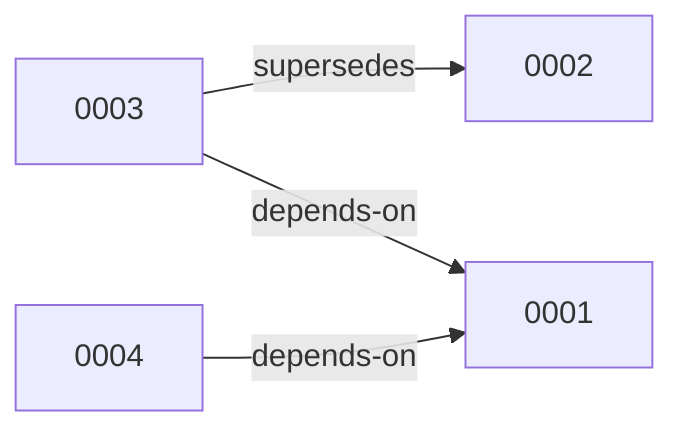
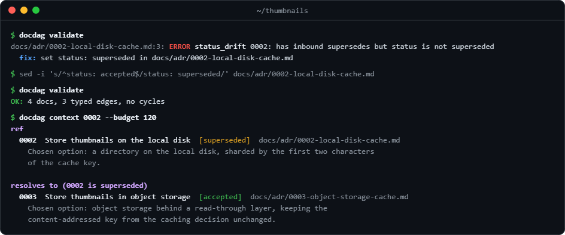

DocDagというCLIツールを作りました。
リポジトリは[こちら](https://github.com/Kaikei-e/DocDag)


## ADR書いていますか？（もしくはAIに）書かせていますか？

生成AIの台頭、SDD（Spec Driven Development）の普及によって、ADRを採用することが増えているのではないでしょうか？
もちろんADR自体は以前から存在していましたが、生成AI以後にはドキュメントが人間とAIとの懸け橋となる為、その重要性を増している感覚です。

そこで課題になるのが、大量に生成される文書をどう管理するかという問題です。

私もSDDでLLMに実装させていくなかで、大量に生成されたADRを管理しきれない、過去のアーキテクチャ上の意思決定と異なる判断を同じ機能やマイクロサービスなどにしてしまう、といった状況に何度も遭遇しました。

そして生成AIに書かせると、ハルシネーションが発生してドキュメントに嘘が混じったり、Markdownのテキスト情報からでは過去のADRを効率よく読み込ませられなかったりする問題も起きます。

つまりドキュメントをテキスト情報としてだけで管理するのは、非効率的で限界があるということです。

単一のアプリケーションや、コードベースが小さいものなら、まだ人間の記憶に頼って記述ができるかもしれません。
しかし、それにも限界はあり、誤りも生じます。

## Altでの運用

[Alt](https://github.com/Kaikei-e/Alt)とは、自作のRSSフィードアグリゲーター・リーダーです。

DocDagは、もともとAlt専用に作った検査ツールを切り出したもので、2026年7月中旬に自作Pythonスクリプトで検査を始め、7月下旬にGoのCLIとして作り直し、7月31日に汎用ツールのDocDagとして独立させてAltに導入しました。
現在は1008本のADRがあり、`docdag validate`の結果は次のとおりです。

```
OK: 1008 docs, 2805 typed edges, no cycles
```

なおDocDagが保証するのは参照先の存在と循環がないことまでで、依存関係として意味的に正しいかどうかは保証しません。

Altを個人で開発するなかで、爆発的に増えるドキュメントを前に、早晩限界を迎えました。最初は数万行程度の規模だったリポジトリは、AIで加速した開発によってADRや機能が爆発的に増加しました。
結果としてリポジトリ全体で数十万行にまで拡大し、現在では約170万行の文書とソースコードを有するまでに至りました。
累計で約346万行を変更して、175万行を消しています。追加と削除の合計で約521万行です。
現時点でADRは1000を超えています。Alt自体はログ用のサイドカー含めて69のマイクロサービスで稼働するマイクロサービス・アーキテクチャのアプリケーションです。
これを人間が把握しきるのは不可能です。

当時グラフによるADR管理の必要性を痛感したのは、ADRの「置き換え」関係を明示しようと洗い直したことがきっかけでした。ADRを洗い出した結果、後続が存在するのに記録されていないADRが約70本出てきました。
`depends-on`辺を書いた結果`status_drift`が出て、`status`の修正が強制されました。


## ADRをグラフ（DAG）として扱う理由

ADR同士には、「0003は0002を置き換える（supersedes）」、「0004は0001を前提にする（depends-on）」といった向きのある関係があります。
この関係を辺とみなすと、ADRの集合は有向グラフになります。



これらの関係は、辿っていくと元の文書に戻ってきてはならないはずです。
AがBを置き換え、BがAを置き換えていたら、どちらの意思決定が有効なのか決められないからです。つまりADRの関係は、本来DAG（有向非巡回グラフ）的であるべきです。DocDagは、この「本来そうあるべき形」を機械的に検査します。

## DocDagの特徴

- YAML frontmatter付きのMarkdownを対象に、型付きの有向グラフとして処理します
- 生成AIにADRを書かせると前述のハルシネーションによる誤記が混じるだけでなく、すでに無効や破棄されたADRが残る問題も生じるため、これらを本文の意味的な誤りでなく構造上の誤りを機械的に解決するものです
- `status`が`accepted`かつ、なににも`supersede`されていない文書を有効なものとして扱います。
- `docdag query --binding`で有効な決定の一覧を、`docdag resolve <ref>`で置き換え先を引けます
- CI向けに`docdag validate`コマンドで診断を出し、CIに一行追加するだけで使えます
- MADR形式がすでにあるリポジトリなら、設定抜きで導入が容易です
- `docdag new`でテンプレートから次の文書を作成し、新規文書が置き換える対象文書との整合性も保ったり、`docdag lint`で設定ファイルのルール健全性チェックが行えて、利用を容易にするためのコマンドがあります
- `docdag context <ref>`の1コマンドで、文書・解決先・近傍をまとめて渡せます
- `--touching`で1つの編集で壊れうる箇所だけ検査する
- Claude Codeプラグインとしても追加可能です
  - AIがADRを書いた直後にフックで検証することも可能


## かんたん入門



この画像では、下記の流れを通して`docdag`コマンドを説明しています。

1. 0003が0002を置き換えているが、0002がacceptedのまま残っている
2. `validate`がそれを`status_drift`として検出し、`fix:`行で直し方を示す
3. 直すとvalidateが通る
4. `context 0002`で、0002は置き換え済みであることと、置き換え先の0003でどう決めたかが一度に返る
